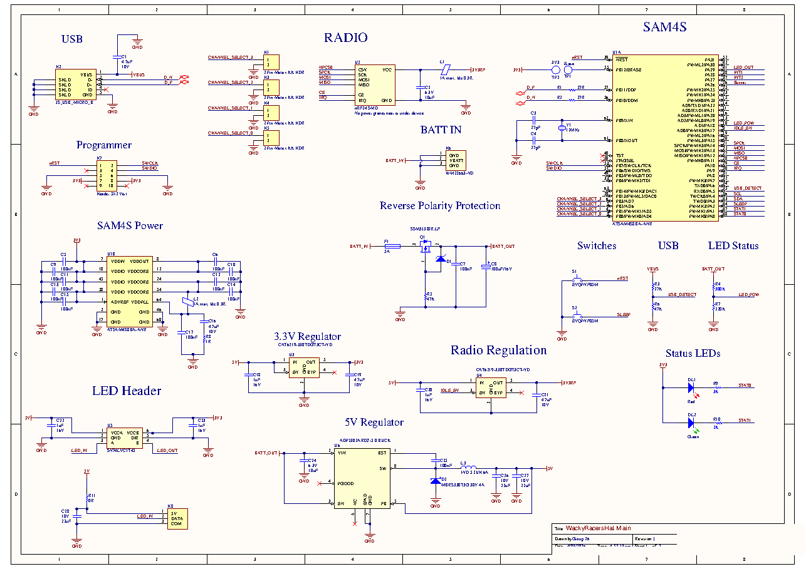

## Overview

This project is a radio-controlled racer driven by a wearable hat controller that steers using head movements. Both the racer and the hat use custom PCBs designed in Altium around SAM4S microcontrollers, with firmware written in C. The system includes:
- Head-movement steering using an accelerometer on the hat
- A wireless radio link between the hat and the racer
- Motor control on the racer using PWM
- A low-power sleep mode on both boards
- LEDs and a buzzer for user feedback

The SolidWorks models of the racer and its mechanisms are in `Model CAD/`.

## Table of Contents

- [Overview](#overview)
- [Table of Contents](#table-of-contents)
- [System Overview](#system-overview)
- [Hardware](#hardware)
- [Software Modularisation](#software-modularisation)

## System Overview

## Hardware
The board designs are in `board_design/`, with one Altium project for the hat and one for the car. The hat board connects to its accelerometer over I2C and to the nRF24 radio over SPI. Shared circuits used the same layout on both boards, which made errors easier to catch and fault finding faster.

## Software Modularisation
The firmware in `src/apps/` is split into three folders:

- `hat` - reads the accelerometer and maps head tilt to speed and steering commands. Dead zones stop small head movements being misread.
- `racer` - receives commands and drives the motors through the PWM driver.
- `common` - code shared by both boards: the radio communication, LEDs and sleep mode.
